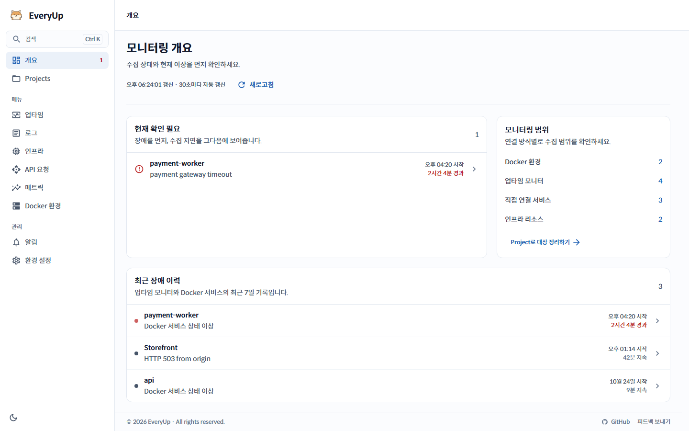

<p align="center">
  
</p>

<h1 align="center">EveryUp</h1>

<p align="center">
  Self-hosted monitoring for uptime, logs, API response times, and server resources, with alerts based on the rules you configure.
</p>

<p align="center">
  <a href="https://ai-turn.github.io/everyup/en/"><b>Docs</b></a> -
  <a href="https://ai-turn.github.io/everyup/demo/"><b>Live Demo</b></a> -
  <a href="README.md">한국어</a>
</p>

<p align="center">
  <a href="https://ai-turn.github.io/everyup/en/"></a>
  <a href="https://ai-turn.github.io/everyup/demo/"></a>
  
  
  
  
</p>

<p align="center">
  
</p>

> **Note:** the dashboard interface is Korean only.

Start with failing targets and delayed collection, then investigate recurring errors and API request
trends. Run **Web** on a dashboard server and install a Docker Collector in each **Docker environment**.
Choose which container state, logs, and host resources to collect, and use the eBPF Observer for API
response times and traces. Application metrics require a separate export configuration.

Check public URLs and TCP ports with [uptime monitors](https://ai-turn.github.io/everyup/en/guide/uptime-monitors).
Apps and servers outside Docker can [connect directly through OpenTelemetry](https://ai-turn.github.io/everyup/en/guide/monitoring-setup#direct-otel).
To receive alerts, configure notification channels and enabled rules.

| Part | What it does | Where it runs |
| --- | --- | --- |
| **Web** | Dashboard, users, alert rules, notification channels, history | Your dashboard server |
| **Docker Collector** | Docker discovery, container state, logs, host metrics | Each Docker host you monitor |

## Quick Start

```bash
mkdir everyup && cd everyup
curl -O https://raw.githubusercontent.com/ai-turn/everyup/main/web/docker-compose.yml
docker compose up -d
```

Open `http://<dashboard server IP>:3001`, create the first admin account, then install the
Collector with **Docker 연결** (Connect Docker) on the **Docker 환경** (Docker environments)
screen. For setting the public address and installing the Collector, see the
[Quick Start docs](https://ai-turn.github.io/everyup/en/guide/quickstart).

## Documentation

| Page | What's inside |
| --- | --- |
| [Introduction](https://ai-turn.github.io/everyup/en/guide/introduction) | Features and what gets collected |
| [Quick Start](https://ai-turn.github.io/everyup/en/guide/quickstart) | Start Web, connect Docker, install the monitoring bundle |
| [Monitoring setup](https://ai-turn.github.io/everyup/en/guide/monitoring-setup) | Diagnose collection, add capabilities, connect OpenTelemetry directly, groups |
| [Uptime monitors](https://ai-turn.github.io/everyup/en/guide/uptime-monitors) | Check responses from public URLs and TCP ports |
| [Automatic eBPF Observer](https://ai-turn.github.io/everyup/en/guide/ebpf-observer) | API response times and traces without app changes, with host requirements |
| [Header & body capture](https://ai-turn.github.io/everyup/en/guide/otel-instrumentation) | Request/response headers and bodies via OpenTelemetry |
| [Notifications](https://ai-turn.github.io/everyup/en/guide/notifications) | Telegram / Discord / Slack channels and alert rules |
| [Upgrade and uninstall](https://ai-turn.github.io/everyup/en/guide/upgrade-uninstall) · [Backup and restore](https://ai-turn.github.io/everyup/en/guide/backup-restore) · [Troubleshooting](https://ai-turn.github.io/everyup/en/guide/troubleshooting) | Operations |
| [Web configuration](https://ai-turn.github.io/everyup/en/reference/web) · [Docker Collector configuration](https://ai-turn.github.io/everyup/en/reference/collector) | Environment variable and networking reference |

## Development

```text
web/
  backend/                 # Go 1.24 API server, SQLite migrations, OTLP ingest
  frontend/                # React 19 / Vite dashboard
agent/                     # Docker Collector (Go 1.25)
docs/                      # Docs site (VitePress) — ai-turn.github.io/everyup
```

Prerequisites for source development: Docker, pnpm, Go 1.24 for Web, and Go
1.25 for the Docker Collector.

```bash
cd web/backend && go test ./...                               # backend tests
cd web/frontend && pnpm lint && pnpm typecheck && pnpm build  # frontend, in CI order
cd agent && go test ./...                                     # Docker Collector tests
pnpm docs:dev                                                 # run the docs site locally
```

`pnpm build` does not type-check, so run `typecheck` separately. If you changed the UI, run
`pnpm test:e2e` in `web/frontend` before merging. The demo e2e runs in PR CI, before Docker image
publication, and in the Pages deploy. Docker images are published only after every check passes
for the same commit. If screens look different, regenerate the docs and README screenshots with
`pnpm screenshot`.

Running each part locally is covered in [web/README.md](web/README.md) and
[agent/README.md](agent/README.md); the instrumentation E2E fixture is in
[e2e/monitoring-target](e2e/monitoring-target/README.md).
