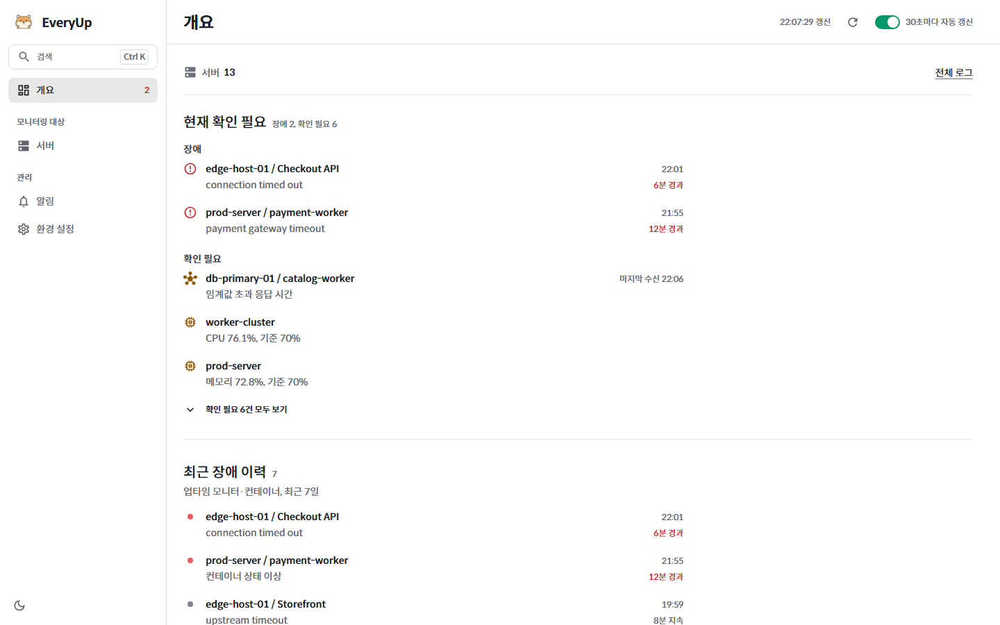

<p align="center">
  
</p>

<h1 align="center">EveryUp</h1>

<p align="center">
  Self-hosted monitoring for uptime, logs, API response times, and server resources, with alerts based on the rules you configure.
</p>

<p align="center">
  <a href="https://ai-turn.github.io/everyup/en/"><b>Docs</b></a> -
  <a href="https://ai-turn.github.io/everyup/demo/"><b>Live Demo</b></a> -
  <a href="README.md">한국어</a>
</p>

<p align="center">
  <a href="https://ai-turn.github.io/everyup/en/"></a>
  <a href="https://ai-turn.github.io/everyup/demo/"></a>
  
  
  
  
</p>

<p align="center">
  
</p>

> **Note:** the dashboard interface is Korean only.

Start with failing targets and delayed collection, then investigate recurring errors and API request
trends. Run **Web** on a dashboard server and install a Docker Collector on the **server** of each Docker host you monitor.
Choose which container state, logs, and host resources to collect, and use the eBPF Observer for API
response times and traces. Application metrics require a separate export configuration.

Check public URLs and TCP ports with [uptime monitors](https://ai-turn.github.io/everyup/en/guide/uptime-monitors).
Apps and servers outside Docker can [connect directly through OpenTelemetry](https://ai-turn.github.io/everyup/en/guide/monitoring-setup#direct-otel).
To receive alerts, configure notification channels and enabled rules.

| Part | What it does | Where it runs |
| --- | --- | --- |
| **Web** | Dashboard, users, alert rules, notification channels, history | Your dashboard server |
| **Docker Collector** | Docker discovery, container state, logs, host metrics | Each Docker host you monitor |

## Quick Start

```bash
mkdir everyup && cd everyup
curl -O https://raw.githubusercontent.com/ai-turn/everyup/main/web/docker-compose.yml
docker compose up -d
```

Open `http://<dashboard server IP>:3001`, create the first admin account, then choose **추가** (Add) on the
**서버** (Servers) screen and pick **Docker Collector 설치** (Install Docker Collector) as the connection
method. For setting the public address and installing the Docker Collector, see the
[Quick Start docs](https://ai-turn.github.io/everyup/en/guide/quickstart).

## Documentation

| Page | What's inside |
| --- | --- |
| [Introduction](https://ai-turn.github.io/everyup/en/guide/introduction) | Features and what gets collected |
| [Quick Start](https://ai-turn.github.io/everyup/en/guide/quickstart) | Start Web, add an uptime monitor, install the Docker Collector |
| [Monitoring setup](https://ai-turn.github.io/everyup/en/guide/monitoring-setup) | Diagnose collection, add capabilities, host metrics source, same-host merge, connect OpenTelemetry directly |
| [Uptime monitors](https://ai-turn.github.io/everyup/en/guide/uptime-monitors) | Check responses from public URLs and TCP ports |
| [Automatic eBPF Observer](https://ai-turn.github.io/everyup/en/guide/ebpf-observer) | API response times and traces without app changes, with host requirements |
| [Header & body capture](https://ai-turn.github.io/everyup/en/guide/otel-instrumentation) | Request/response headers and bodies via OpenTelemetry |
| [Notifications](https://ai-turn.github.io/everyup/en/guide/notifications) | Telegram / Discord / Slack channels and alert rules |
| [Upgrade and uninstall](https://ai-turn.github.io/everyup/en/guide/upgrade-uninstall) · [Backup and restore](https://ai-turn.github.io/everyup/en/guide/backup-restore) · [Troubleshooting](https://ai-turn.github.io/everyup/en/guide/troubleshooting) | Operations |
| [Web configuration](https://ai-turn.github.io/everyup/en/reference/web) · [Docker Collector configuration](https://ai-turn.github.io/everyup/en/reference/collector) | Environment variable and networking reference |

## Development

```text
web/
  backend/                 # Go 1.24 API server, SQLite migrations, OTLP ingest
  frontend/                # React 19 / Vite dashboard
agent/                     # Docker Collector (Go 1.25)
docs/                      # Docs site (VitePress) — ai-turn.github.io/everyup
```

Prerequisites for source development: Docker, pnpm, Go 1.24 for Web, and Go
1.25 for the Docker Collector.

```bash
cd web/backend && go test ./...                               # backend tests
cd web/frontend && pnpm lint && pnpm typecheck && pnpm build  # frontend, in CI order
cd agent && go test ./...                                     # Docker Collector tests
pnpm docs:dev                                                 # run the docs site locally
```

`pnpm build` does not type-check, so run `typecheck` separately. If you changed the UI, run
`pnpm test:e2e` in `web/frontend` before merging. If screens look different, regenerate the docs
and README screenshots with `pnpm screenshot`.

### CI, releases, and the demo

There are three GitHub Actions workflows, and none waits on another.

| Workflow | Runs on | Does |
| --- | --- | --- |
| **Verify** (`ci.yml`) | PRs, pushes to main | Checks only. Never publishes images or deploys Pages. |
| **Release** (`release.yml`) | `v*` tag pushes, manual runs (name an existing tag) | Reruns every Verify check on the tagged commit, then publishes both Docker images. |
| **Deploy demo** (`deploy-pages.yml`) | Manual runs (pick a ref, default main), `v*` tag pushes | Builds the docs and demo from that ref, runs the demo e2e, and deploys to GitHub Pages. |

A push to main reuses the e2e result when a PR run already passed e2e on the identical git tree, and
runs e2e otherwise; to force it on main, use **Run workflow** on Verify. Merging to main changes no
image tag and does not touch the public demo.

**Cutting a release**: tag the commit on main and push the tag
(`git tag v1.2.0 && git push origin v1.2.0`), or create a GitHub release with a new tag of that name.
Release publishes the images, and when the tag is the newest stable version, Deploy demo also moves
the demo to it. To retry a failed release, run Actions → Release → **Run workflow** with the tag name.

**Image tags**: every published commit gets `sha-<commit>`. Every release tag gets `X.Y.Z`; `X.Y`
and `latest` move only for a stable version (no suffix such as `-rc.1`) newer than every existing
stable version. So `latest` is the newest stable release, and re-publishing an old version or cutting
a prerelease (`v1.3.0-rc.1`) leaves it alone.

**Deploying the demo by hand**: Actions → Deploy demo → **Run workflow**, and enter a branch, tag, or
commit (empty means main). A manual run always deploys the ref you chose.

Running each part locally is covered in [web/README.md](web/README.md) and
[agent/README.md](agent/README.md); the instrumentation E2E fixture is in
[e2e/monitoring-target](e2e/monitoring-target/README.md).
