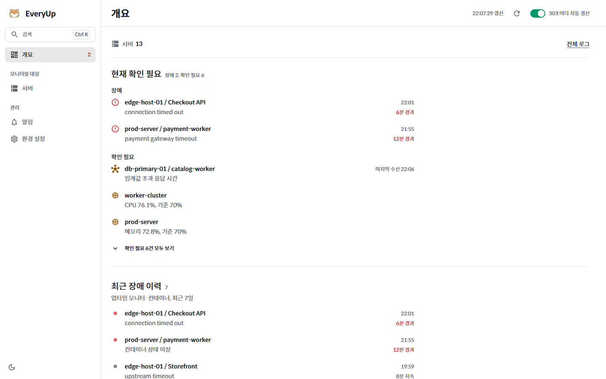

<p align="center">
  
</p>

<h1 align="center">EveryUp</h1>

<p align="center">
  업타임·로그·API 응답 시간·서버 자원을 함께 확인하고, 설정한 규칙에 따라 알림을 받는 셀프호스팅 모니터링.
</p>

<p align="center">
  <a href="https://ai-turn.github.io/everyup/"><b>문서</b></a> -
  <a href="https://ai-turn.github.io/everyup/demo/"><b>Live Demo</b></a> -
  <a href="README.en.md">English</a>
</p>

<p align="center">
  <a href="https://ai-turn.github.io/everyup/"></a>
  <a href="https://ai-turn.github.io/everyup/demo/"></a>
  
  
  
  
</p>

<p align="center">
  
</p>

장애가 난 대상과 수집이 지연된 대상을 먼저 확인하고, 반복 오류와 API 요청 추이를 따라 문제를 조사하세요.
대시보드 서버에서 **Web**을 실행하고, 모니터링할 Docker 호스트마다 그 **서버**에 Docker Collector를 설치합니다.
선택한 범위의 컨테이너 상태·로그·호스트 자원을 수집하고, eBPF Observer로 API 응답 시간과 트레이스를
수집할 수 있습니다. 앱 메트릭은 별도로 전송하도록 설정해야 합니다.

공개 URL·TCP 포트는 [업타임 모니터](https://ai-turn.github.io/everyup/guide/uptime-monitors)로 확인하세요.
Docker 밖의 앱과 서버는 [OpenTelemetry로 직접 연결](https://ai-turn.github.io/everyup/guide/monitoring-setup#direct-otel)할 수 있습니다.
알림을 받으려면 채널과 활성 규칙을 설정하세요.

| 구성 | 역할 | 실행 위치 |
| --- | --- | --- |
| **Web** | 대시보드, 사용자, 알림 규칙·채널, 히스토리 | 대시보드 서버 |
| **Docker Collector** | Docker 컨테이너 자동 발견, 컨테이너 상태, 로그, 호스트 메트릭 | 모니터링할 각 Docker 호스트 |

## 빠른 시작

```bash
mkdir everyup && cd everyup
curl -O https://raw.githubusercontent.com/ai-turn/everyup/main/web/docker-compose.yml
docker compose up -d
```

`http://<대시보드 서버 IP>:3001`에서 첫 관리자 계정을 만든 뒤, **서버** 화면의 **추가**에서
연결 방식으로 **Docker Collector 설치**를 골라 Docker Collector를 설치합니다. 외부 접속 주소 지정과 Docker Collector 설치는
[Quick Start 문서](https://ai-turn.github.io/everyup/guide/quickstart)를 참고하세요.

## 문서

| 문서 | 내용 |
| --- | --- |
| [소개](https://ai-turn.github.io/everyup/guide/introduction) | 핵심 기능과 수집되는 데이터 |
| [Quick Start](https://ai-turn.github.io/everyup/guide/quickstart) | Web 실행, 업타임 모니터 추가, Docker Collector 설치 |
| [모니터링 설정](https://ai-turn.github.io/everyup/guide/monitoring-setup) | 수집 상태 진단, 기능 추가, 호스트 지표 출처, 같은 호스트 합치기, OpenTelemetry 직접 연결 |
| [업타임 모니터](https://ai-turn.github.io/everyup/guide/uptime-monitors) | 공개 URL·TCP 포트 응답 확인 |
| [자동 eBPF Observer](https://ai-turn.github.io/everyup/guide/ebpf-observer) | 앱 수정 없이 API 응답 시간·트레이스 수집, 지원 조건 확인 |
| [헤더·바디 상세 수집](https://ai-turn.github.io/everyup/guide/otel-instrumentation) | OpenTelemetry로 요청/응답 헤더·바디 수집 |
| [알림](https://ai-turn.github.io/everyup/guide/notifications) | Telegram / Discord / Slack 채널과 알림 규칙 |
| [업그레이드·제거](https://ai-turn.github.io/everyup/guide/upgrade-uninstall) · [백업·복원](https://ai-turn.github.io/everyup/guide/backup-restore) · [트러블슈팅](https://ai-turn.github.io/everyup/guide/troubleshooting) | 운영 |
| [Web 설정](https://ai-turn.github.io/everyup/reference/web) · [Docker Collector 설정](https://ai-turn.github.io/everyup/reference/collector) | 환경변수·네트워킹 레퍼런스 |

## 개발

```text
web/
  backend/                 # Go 1.24 API 서버, SQLite migration, OTLP ingest
  frontend/                # React 19 / Vite 대시보드
agent/                     # Docker Collector (Go 1.25)
docs/                      # 문서 사이트 (VitePress) — ai-turn.github.io/everyup
```

소스 개발 사전 요구사항: Docker, pnpm, Web용 Go 1.24, Docker Collector용 Go 1.25.

```bash
cd web/backend && go test ./...                               # 백엔드 테스트
cd web/frontend && pnpm lint && pnpm typecheck && pnpm build  # 프론트엔드 (CI와 같은 순서)
cd agent && go test ./...                                     # Docker Collector 테스트
pnpm docs:dev                                                 # 문서 사이트 로컬 실행
```

`pnpm build`는 타입을 검사하지 않으므로 `typecheck`를 따로 돌립니다. UI를 바꿨다면 머지 전에
`web/frontend`에서 `pnpm test:e2e`를 실행하세요. 화면 모습이 바뀌었다면 `pnpm screenshot`으로
문서와 README의 스크린샷을 다시 만듭니다.

### CI·릴리스·데모 배포

GitHub Actions 워크플로는 세 개이고, 서로를 기다리지 않습니다.

| 워크플로 | 언제 실행되나 | 하는 일 |
| --- | --- | --- |
| **Verify** (`ci.yml`) | PR, main 푸시 | 검사만 합니다. 이미지 발행이나 Pages 배포는 하지 않습니다. |
| **Release** (`release.yml`) | `v*` 태그 푸시, 수동 실행(기존 태그 지정) | 태그 커밋에서 Verify 검사를 모두 다시 돌리고, 통과하면 Docker 이미지 두 개를 발행합니다. |
| **Deploy demo** (`deploy-pages.yml`) | 수동 실행(ref 지정, 기본 main), `v*` 태그 푸시 | 그 ref로 문서와 데모를 빌드하고 데모 e2e를 통과하면 GitHub Pages에 배포합니다. |

main 푸시는 같은 git 트리가 PR 실행에서 이미 e2e를 통과했으면 그 결과를 재사용하고, 그렇지 않으면
e2e를 다시 실행합니다. main에서 e2e를 강제로 다시 돌리려면 Actions의 Verify에서 **Run workflow**를
실행합니다. main에 머지해도 이미지 태그나 공개 데모는 바뀌지 않습니다.

**릴리스 만들기**: main의 릴리스할 커밋에 `vX.Y.Z` 태그를 붙여 푸시합니다
(`git tag v1.2.0 && git push origin v1.2.0`). GitHub에서 같은 이름의 태그로 Release를 만들어도
됩니다. Release 워크플로가 이미지를 발행하고, 그 태그가 가장 새 정식 버전이면 Deploy demo도 자동으로
데모를 그 버전으로 바꿉니다. 실패한 릴리스는 Actions → Release → **Run workflow**에 태그 이름을
넣어 다시 실행합니다.

**이미지 태그**: `sha-<커밋>`은 발행한 모든 커밋에 붙습니다. `X.Y.Z`는 모든 릴리스 태그에,
`X.Y`와 `latest`는 정식 버전(`v1.2.0`처럼 `-rc.1` 같은 접미사가 없는 태그)이 기존의 어떤 정식
버전보다도 새로울 때만 옮겨집니다. 따라서 `latest`는 가장 최근 정식 릴리스를 뜻하며, 옛 버전을
다시 발행하거나 프리릴리스(`v1.3.0-rc.1`)를 내도 바뀌지 않습니다.

**데모 직접 배포**: Actions → Deploy demo → **Run workflow**에서 ref(브랜치, 태그, 커밋)를
입력합니다. 비워 두면 main을 배포합니다. 수동 실행은 고른 ref가 그대로 배포됩니다.

로컬 실행 방법은 [web/README.md](web/README.md)와 [agent/README.md](agent/README.md),
상세 수집 E2E fixture는 [e2e/monitoring-target](e2e/monitoring-target/README.ko.md)에 있습니다.
